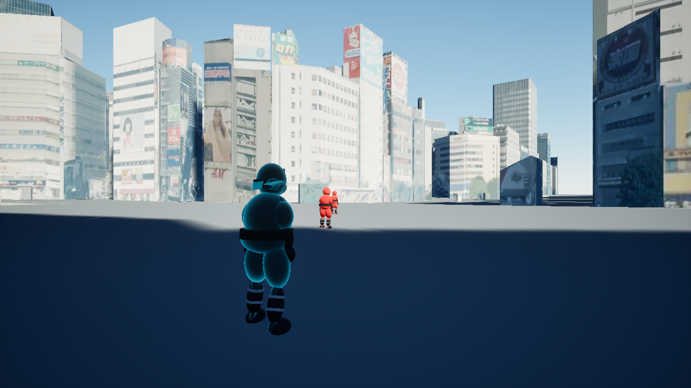
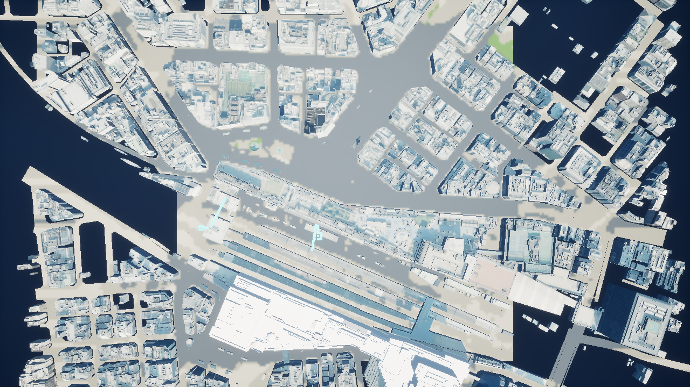
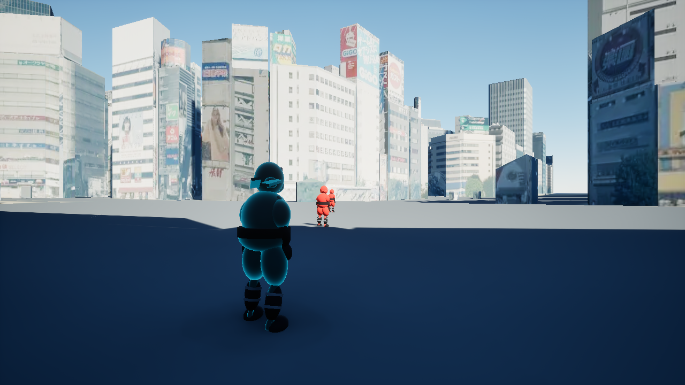
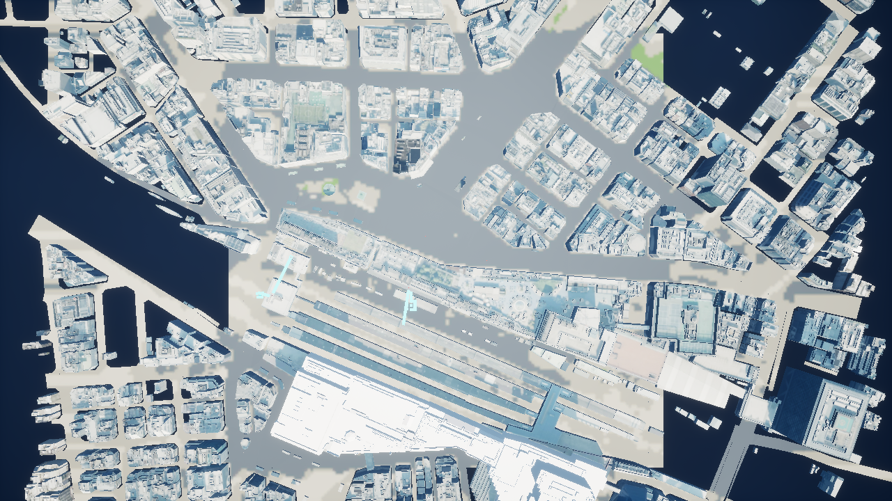

# 航空写真から推定した地面色（2026-10-19）

国土地理院の航空写真をもとに、白かった地面・道路を大まかに色分けした。写真の屋根や影をそのまま地面へ貼る代わりに、粗い色分類と既存道路形状を組み合わせている。





## データと位置合わせ

ユーザーの明示承認後に、国土地理院の公式資料と `seamlessphoto` のズーム17タイル12枚を取得した。地図の400m四方と周囲150mを含む700m四方が対象。原本は `Downloads/GSI/`、資料は `doc/references/` に保存した。[取得元と利用条件](references/gsi-ground-sources.md)を参照。

既存のCesium原点（東経139.7109度、北緯35.7295度、高さ60m）を使用し、UEの各位置から緯度・経度へ戻して写真をサンプリングする。画像の横が東方向、縦が南方向。地面と道路の両方で同じWorldPositionのXY座標を参照するため、メッシュのUVの違いによるずれを避けられる。

## 色の作成

1. UEに含まれる画像読み取り機能でJPEGを展開し、1024×1024の位置合わせ済み画像を作成。
2. 256×256の格子（約2.73m単位）で写真の平均色を計算。緑・暗い舗装・明るい舗装・土色・中間色の5種類へ分類。
3. 既存の `SM_RoadsCollision` の12,247三角形を上からラスタライズし、道路範囲を灰色へ補正。木の冠や建物の影が道路色を細かく分断するのを抑える。
4. 周辺の多数決と拡大時の補間で小さな斑点を抑え、1024×1024の色画像を生成。
5. `T_CityGroundColors` と `M_CityGroundPhotoColors` を作成し、補完地面とCesium道路タイルへ適用。

生成物のカバー範囲はUE座標（cm）で `[-23000,-38000]` から `[47000,32000]`。撮影日を特定した写真ではなく、取得日と撮影日は区別する。現実の土地利用・舗装材を正確に分類したものではなく、ゲームの見た目を整えるための推定色。今回の分類では土色に該当するセルはなかった。

## 安全に保持したもの

保存前後で60個のStaticMeshActorのメッシュ参照・位置等のTransform・衝突プロファイルが同一であることを確認。地形や足場は作り直さず、色を参照するマテリアルだけを変更した。元マップは `Backups/GroundColors-20261019/L_Ikebukuro.umap` に保存。

追加の画像ライブラリ・外部ツールのダウンロードは行わず、承認済みUEのImageCore/ImageUtilsを使用した。写真原本は作成工程で参照し、完成ゲームには派生テクスチャをCookして同梱する。ゲームから国土地理院へ通信するコードは追加していない。

初回の描画でComponentMaskの入力接続が欠け、代替の格子模様が出る問題を目視で検出した。接続名を修正し、接続失敗の検知とシェーダーのコンパイル失敗をログで検知する処理を追加。修正後の地上・俯瞰画像で色の表示を確認した。

## 再作成

`Tools/City/plan_ground_photo.py` が取得範囲と公式URLを `Downloads/GSI/ground-photo-manifest.json` に出力する。写真の再取得にはこの会話の承認範囲を守り、同フォルダの原本・URL・SHA-256を確認する。

```powershell
./Tools/Editor/Build-Step1.ps1
./Tools/Editor/Verify-GroundColors.ps1 -Baseline -RunName ground-colors-before
./Tools/Editor/Setup-GroundColors.ps1
./Tools/Editor/Verify-GroundColors.ps1 -RunName ground-colors-after-r2
./Tools/Editor/Package-Step10.ps1 -OutputDirectory SavedBuilds/GroundColors/Package
./Tools/Editor/Prepare-Step10.ps1 -BuildDirectory SavedBuilds/GroundColors -ReportPrefix ground-colors -Relocate
./Tools/Editor/Verify-GroundColors.ps1 -RunName ground-colors-package -PackagePath 'SavedBuilds/GroundColors/Relocated Windows'
./Tools/Editor/Verify-Step10.ps1 -Check Match -RunName ground-colors-package-match -PackagePath 'SavedBuilds/GroundColors/Relocated Windows'
& 'C:/Program Files/Epic Games/UE_5.8/Engine/Binaries/ThirdParty/Python3/Win64/python.exe' Tools/Editor/finalize_step10.py --build-directory SavedBuilds/GroundColors --archive-name IkebukuroNinjaCity-GroundColors-Windows.zip --report-name ground-colors-release
```

既存のRunNameや配布物は上書きを拒否するため、再実行時は新しい保存名を使う。変更前撮影は旧マップの段階で実行した記録であり、適用済みマップでBaselineを指定しても旧配色へ戻す処理ではない。

## 確認結果

エディタ版で、写真の全サンプルが取得済み範囲に収まることと、地面・道路の両方のマテリアル設定、描画を確認。Win64 Shippingのビルド・Cook・Archiveが成功し、別フォルダへコピーしたEXEでも着色と建物テクスチャが描画された。配布版で手裏剣・踏みつけ・勝敗・ポーズ・3連続リトライ等の25項目が成功した。

| 記録 | 確認内容 |
| --- | --- |
| `validation/ground-colors-generation.json` | 写真12枚、全画素の取得範囲内カバー、1024画像、分類格子256、道路12,247三角形 |
| `validation/ground-colors-setup.json` | 60個のStaticMeshActorのメッシュ・Transform・衝突プロファイル同一 |
| `validation/ground-colors-editor.json` | 修正後のエディタ描画とマテリアル設定 |
| `validation/ground-colors-package.json` | Cook済みL_Ikebukuro、地上・俯瞰の配布版描画 |
| `validation/ground-colors-package-match.json` | 実入力・実弾・踏みつけを含む25項目。既存の固定時間・旧300秒タイマー検証を使用 |
| `validation/ground-colors-staging.json` | 地図・音楽・説明等55ファイルのSHA-256一致 |
| `validation/ground-colors-relocation.json` | 配布マニフェスト90ファイルすべてが検証用コピーとSHA-256一致 |
| `validation/ground-colors-release.json` | ZIP全エントリCRC確認成功、サイズ・SHA-256 |





今回、BGMの全曲再生・別PC・OSのネットワーク切断状態での試験・性能ベンチマークは繰り返していない。描画と進行の確認ではUEのHTTPを無効化して実行した。

## 配布物

- 起動：`SavedBuilds/GroundColors/Package/Windows/IkebukuroNinjaCity.exe`
- ZIP：`SavedBuilds/GroundColors/IkebukuroNinjaCity-GroundColors-Windows.zip`
- ZIPサイズ：454,219,614 bytes（約454MB）
- ZIP SHA-256：`e4e379e16ec36dc26babb1f591a4e78a3ba1c138da2da9e2cdd52f25a0c9f20f`
- 以前の配布物は別フォルダに保持。

今回も、作業開始時から存在するREADME・uproject・MatchDirector・HUDの差分と原本M4Aは保持する。この変更のコミットには含めないが、配布版には現在の作業ツリーの既存変更も反映される。
