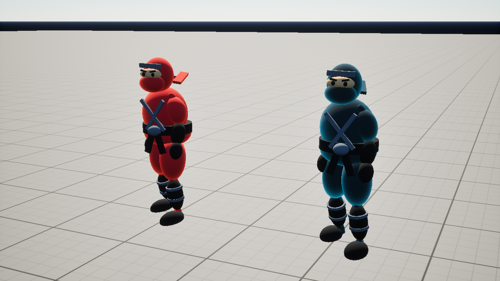
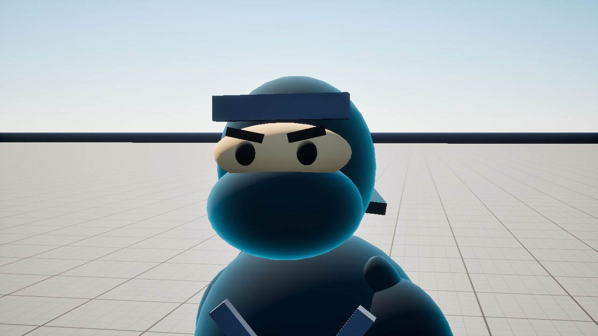

# 忍者のデフォルメ衣装（2026-10-19）

参考イラストの頭巾・目元の開口・覆面・帯・ゆったりした忍者服を、既存UE形状で立体化した。黒忍者と赤忍者に共通のシルエットを使い、服の色で陣営を区別する。

- 大きめの頭巾、肌色の目元、黒い目と眉、口元を覆う同色の布。
- 胸元の合わせ、太い帯、結び目と垂れた帯。
- ふくらんだ袖とズボン、手袋、すね当て、足袋。
- 背面の頭巾の結び目と2本の布。





## 実装

`FNinjaAppearance::Apply` が両陣営の衣装を構成する。各キャラクター35パーツを既存の頭・胴・腕・脚の骨へ取り付け、現在のアニメーションに追従させる。既存マテリアルを共有し、肌色の `M_NinjaSkin` と布端の `M_NinjaWrap` を追加した。

衣装パーツの衝突・オーバーラップ・ナビゲーションへの影響を無効にし、当たり判定は既存のキャラクターカプセルを使う。衣装の追加シャドウパスを無効にし、既存スケルタルメッシュが影を作る。移動・ジャンプ・攻撃の設定変更は含まない。

外部素材やコードの取得は行っていない。承認済みUE 5.8・MSVC・Windows SDKでビルドと描画を確認した。参照画像を見るための追加のフォルダ外アクセスは行っていない。

## 再作成・確認

```powershell
./Tools/Editor/Build-Step1.ps1
./Tools/Editor/Setup-NinjaCostume.ps1
./Tools/Editor/Verify-NinjaCostume.ps1 -RunName ninja-costume-r2
./Tools/Editor/Package-Step10.ps1 -OutputDirectory SavedBuilds/NinjaCostume/Package
./Tools/Editor/Prepare-Step10.ps1 -BuildDirectory SavedBuilds/NinjaCostume -ReportPrefix ninja-costume -Relocate
./Tools/Editor/Verify-Step10.ps1 -Check Volley -RunName ninja-costume-package-volley -PackagePath 'SavedBuilds/NinjaCostume/Relocated Windows'
./Tools/Editor/Verify-Step10.ps1 -Check Match -RunName ninja-costume-package-match -PackagePath 'SavedBuilds/NinjaCostume/Relocated Windows'
& 'C:/Program Files/Epic Games/UE_5.8/Engine/Binaries/ThirdParty/Python3/Win64/python.exe' Tools/Editor/finalize_step10.py --build-directory SavedBuilds/NinjaCostume --archive-name IkebukuroNinjaCity-NinjaCostume-Windows.zip --report-name ninja-costume-release
```

撮影は専用フラグがある場合だけ実行し、通常プレイでは実行しない。正面・背面・顔アップ・ジャンプの画像を `Saved/Validation/ninja-costume-r2-*.png` に保存した。両陣営の衣装が表示され、骨に追従することを目視確認。全35パーツ×2人が非衝突であることも確認した。

Win64 Shippingのビルド・Cook・Archiveが成功。別フォルダのEXEを起動し、赤忍者の3方向弾・射程・壁・一撃敗北等の14項目と、実際のF入力による手裏剣・下降中の踏みつけ・勝敗・ポーズ・3連続リトライ等の25項目が成功した。建物テクスチャと赤忍者の衣装が配布版でも描画されることを確認した。

- `doc/validation/ninja-costume-preview.json`：両陣営35パーツ、非衝突の確認。
- `doc/validation/ninja-costume-package-volley.json`：敵の射撃・衝突の14項目。
- `doc/validation/ninja-costume-package-match.json`：ゲーム進行の25項目。固定時間の300秒タイマーを短縮して境界を確認する既存チェックを使用。
- `doc/validation/ninja-costume-staging.json`：地図・音楽・配布説明55ファイルのSHA-256一致。
- `doc/validation/ninja-costume-relocation.json`：配布マニフェストの90ファイルすべてが検証用コピーとSHA-256一致。
- `doc/validation/ninja-costume-release.json`：ZIPの全エントリCRC確認とSHA-256。

音楽の実時間全曲再生、別PC試験、広範囲の性能ベンチマークは今回再実施していない。衣装のアニメーション確認は正面・背面・ジャンプのサンプルで、すべての姿勢での細かな食い込みを網羅するものではない。

## 更新版

- 起動：`SavedBuilds/NinjaCostume/Package/Windows/IkebukuroNinjaCity.exe`
- ZIP：`SavedBuilds/NinjaCostume/IkebukuroNinjaCity-NinjaCostume-Windows.zip`
- ZIP容量：454,093,418 bytes（約454MB）
- SHA-256：`54f439670d8b75b30bdd3d6b24f39ff321c9188e568829f4c36f519168718997`

従来のStep 10配布版を保持し、新しい保存先に出力した。パッケージ作成・照合・ZIP作成スクリプトは出力先の指定を追加し、プロジェクト外の指定を拒否する。従来の既定値は維持する。

作業開始時からあるREADME、uproject、MatchDirector、HUDの変更、およびルートの原本M4Aは保持し、本変更のコミットには含めない。配布版は現在の作業ツリー全体から作成するため、既存の未コミット変更も反映する。
